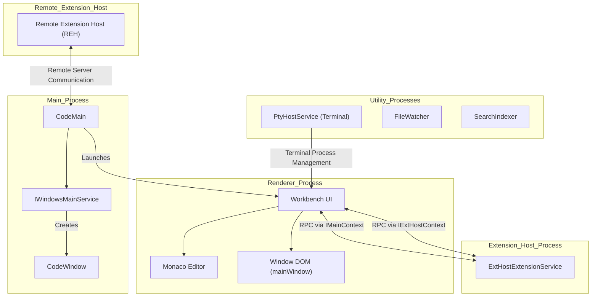

# VS Code Architecture Overview

Visual Studio Code is built on a multi-process, layered architecture designed to enable a highly responsive user experience while managing complex features such as language intelligence, debugging, integrated terminal, and AI-enhanced capabilities. VS Code runs as a native desktop application (via Electron), can be hosted in a web browser, or connect remotely to extension hosts on servers or containers [package.json1-12](https://github.com/microsoft/vscode/blob/230f18f3/package.json#L1-L12)

## Multi-Process Model

VS Code distributes responsibility across multiple processes to maintain UI responsiveness under heavy workloads such as syntax analysis, running extensions, or terminal emulation [src/vs/workbench/browser/web.main.ts1-48](https://github.com/microsoft/vscode/blob/230f18f3/src/vs/workbench/browser/web.main.ts#L1-L48):

-   **Main Process**: The Electron main process controls the overall application lifecycle, window management, native OS integrations, and handles command-line arguments. Core main entry points include `CodeMain` and interfaces like `IWindowsMainService` that create and own `CodeWindow` instances [package.json9-12](https://github.com/microsoft/vscode/blob/230f18f3/package.json#L9-L12)
-   **Renderer Process**: Each visible editor window runs its own renderer process hosting the `Workbench` UI layer. This includes all UI components—editor groups, sidebars, activity bar, status bar, and embedded Monaco editor [src/vs/workbench/browser/web.main.ts13-18](https://github.com/microsoft/vscode/blob/230f18f3/src/vs/workbench/browser/web.main.ts#L13-L18)
-   **Extension Host Process**: Isolated processes running VS Code extensions separate from the UI thread, communicating asynchronously using RPC protocols. This sandboxing ensures robustness and security [src/vs/workbench/workbench.common.main.ts10](https://github.com/microsoft/vscode/blob/230f18f3/src/vs/workbench/workbench.common.main.ts#L10-L10)
-   **Utility Processes**: Dedicated child processes serve background tasks including terminal PTY hosts, file system watchers, and search indexing to keep the UI performant [package.json22-26](https://github.com/microsoft/vscode/blob/230f18f3/package.json#L22-L26)
-   **Remote Extension Host (REH)**: Specialized hosts running extensions remotely on containers, SSH, WSL, or cloud servers, enabling remote development scenarios backed by protocols and remote agent services [remote/package.json2-5](https://github.com/microsoft/vscode/blob/230f18f3/remote/package.json#L2-L5)

### Multi-Process Architecture Diagram

Sources:

-   `package.json` [9-26](https://github.com/microsoft/vscode/blob/230f18f3/9-26)
-   `remote/package.json` [2-5](https://github.com/microsoft/vscode/blob/230f18f3/2-5)
-   `src/vs/workbench/browser/web.main.ts` [13-48](https://github.com/microsoft/vscode/blob/230f18f3/13-48)
-   `src/vs/workbench/workbench.common.main.ts` [10-10](https://github.com/microsoft/vscode/blob/230f18f3/10-10)

## Repository Structure and Build System

The VS Code repository is organized to support building for multiple runtime targets, including Electron desktop, browsers, and remote extension hosts [package.json25-35](https://github.com/microsoft/vscode/blob/230f18f3/package.json#L25-L35):

-   **`src/`**: The primary TypeScript source code for platform services, editor, workbench UI, extensions, and core modules [src/package.json1-31](https://github.com/microsoft/vscode/blob/230f18f3/src/package.json#L1-L31)
-   **`extensions/`**: Built-in and marketplace extensions (e.g., Git integration, Markdown preview, AI Copilot) [extensions/copilot/package-lock.json1-15](https://github.com/microsoft/vscode/blob/230f18f3/extensions/copilot/package-lock.json#L1-L15)
-   **`build/`**: Build tooling, including Gulp tasks, Rspack and Vite bundling, and CI/CD configurations [package.json58-65](https://github.com/microsoft/vscode/blob/230f18f3/package.json#L58-L65)
-   **`cli/`**: Rust-based CLI tools for server hosting, tunnels, and AI agent interaction [package.json48-50](https://github.com/microsoft/vscode/blob/230f18f3/package.json#L48-L50)
-   **`remote/`**: Remote Extension Host (REH) server and web integration code supporting remote development scenarios [remote/package.json1-5](https://github.com/microsoft/vscode/blob/230f18f3/remote/package.json#L1-L5)
