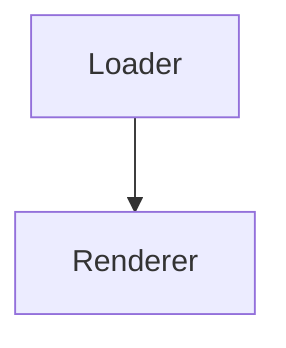

## Widget overview

The widget renders interactive charts from your own data. This page explains how to install it, how to embed it in a page, and how the pieces fit together.

## Installation

Install the package with your package manager of choice. The widget ships as an ES module and works in every modern browser.

```bash
npm install @example/widget --save
```

Import it once at the top of your bundle:

```js
import { createWidget } from '@example/widget';

const widget = createWidget('#chart', { type: 'bar' });
widget.render(data);
```

## Usage

Pass the container element and a configuration object. The widget takes care of sizing, theming and accessibility on its own.

-   `type` — the chart type to render
-   `theme` — a named theme or a custom palette
-   `onSelect` — a callback fired when the user picks a data point

## Architecture

The system is split into a loader, a renderer and a transport. The loader fetches the data, the renderer draws it and the transport keeps the two in sync when the source changes.



That is the whole pipeline. Nothing else is required to get started, and every piece can be replaced independently.

| Option | Type | Default |
| --- | --- | --- |
| `type` | string | `bar` |
| `theme` | string | `light` |
